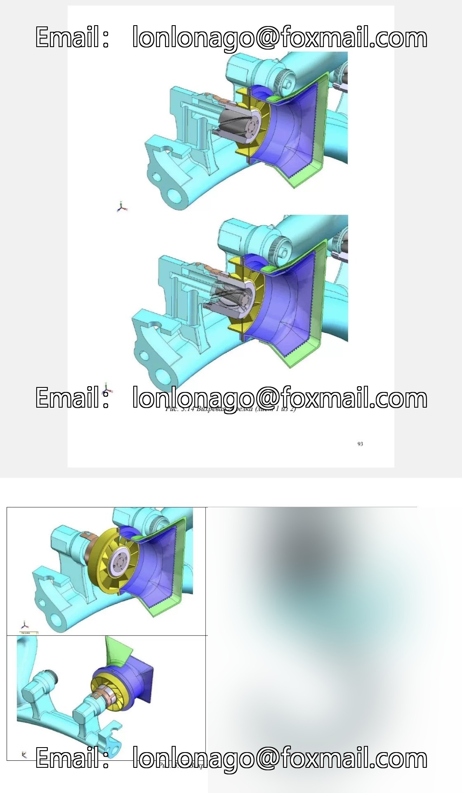
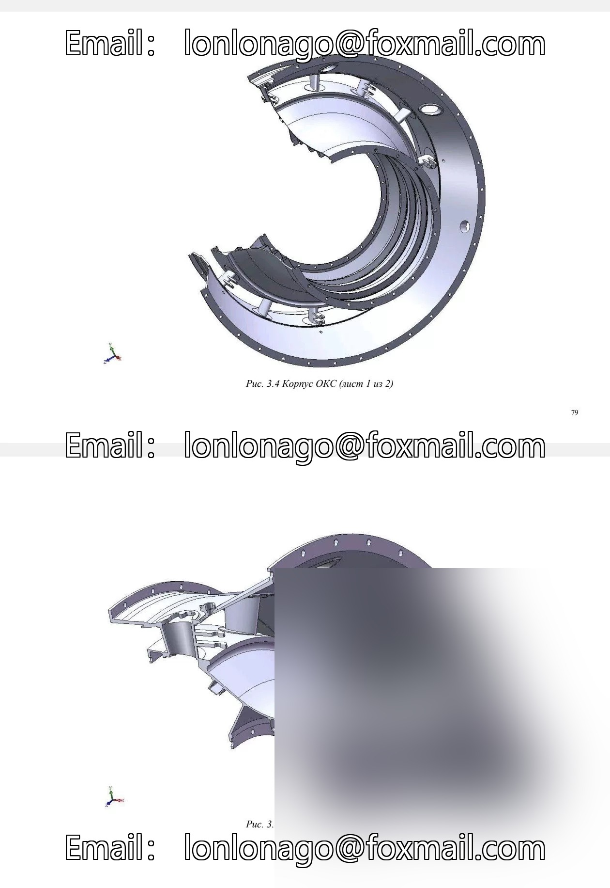
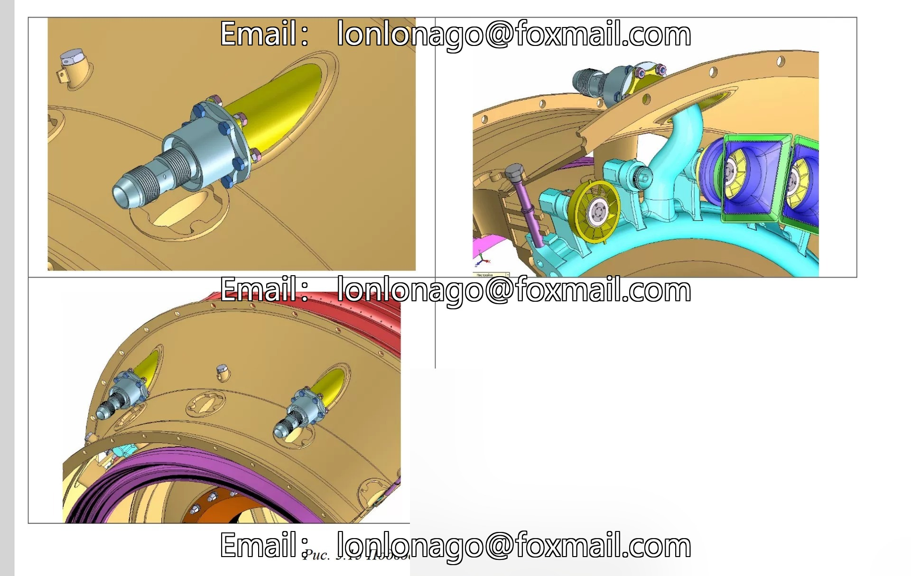
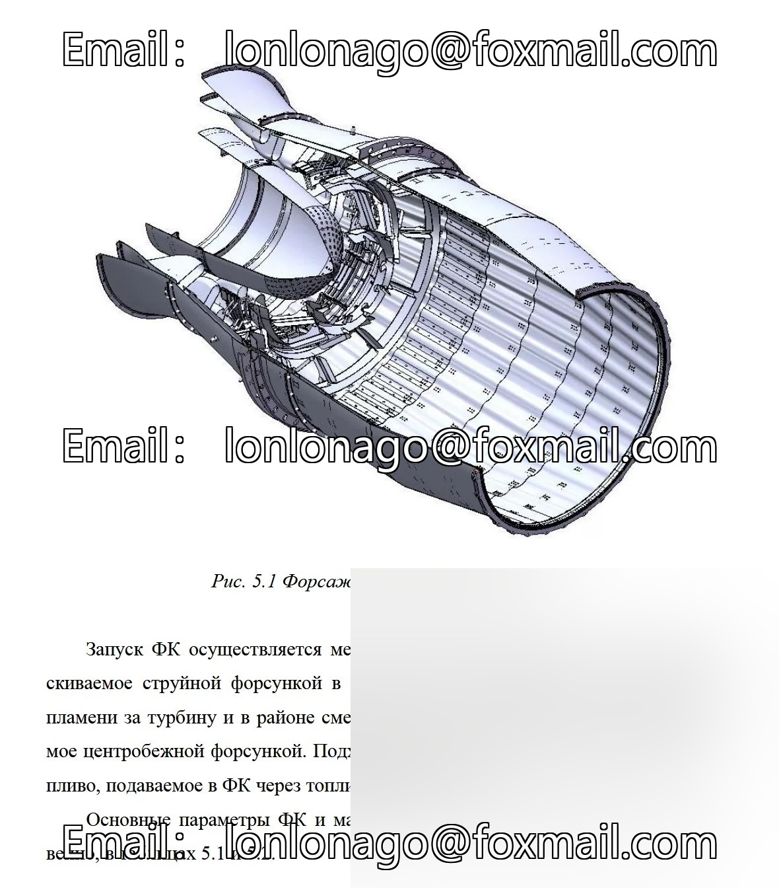
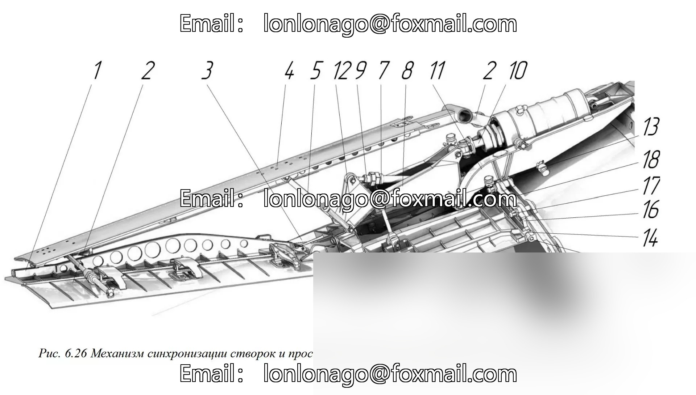

# AL-31F turbine engine structure

## Body

AL-31F turbofan engine structure
Published by an official educational institution under the Russian Federation Ministry of Education and Science.
PDF file, 246 pages.
The publishing unit is Samara State Aerospace University (named after Academician Korolev), which is one of the most top-tier and prestigious research universities in Russia in the field of aviation engines. This ensures the authority and professionalism of the textbook content.

Core content: The textbook specifically and systematically explains the construction of the AL-31F engine. This usually includes the detailed structural design, materials, and working principles of all key components, such as the overall layout, fan, compressor, combustion chamber, turbine, afterburner combustion chamber, and control system.

The AL-31F turboshaft engine structure content covers the general layout, fan, compactor, combustor, turbine, fuel-air combustion chamber and control system for detailed design, materials and principles.

<!-- AI_ENRICHED -->

## Images

## Payment

Here is a pay link on Stripe ( https://buy.stripe.com/3cs8yP7sY87d0vu9AB ). Please contact me lonlonago@foxmail.com after funding $89, and I will send you a complete data files , thank you!

